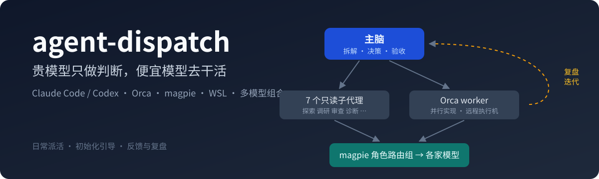
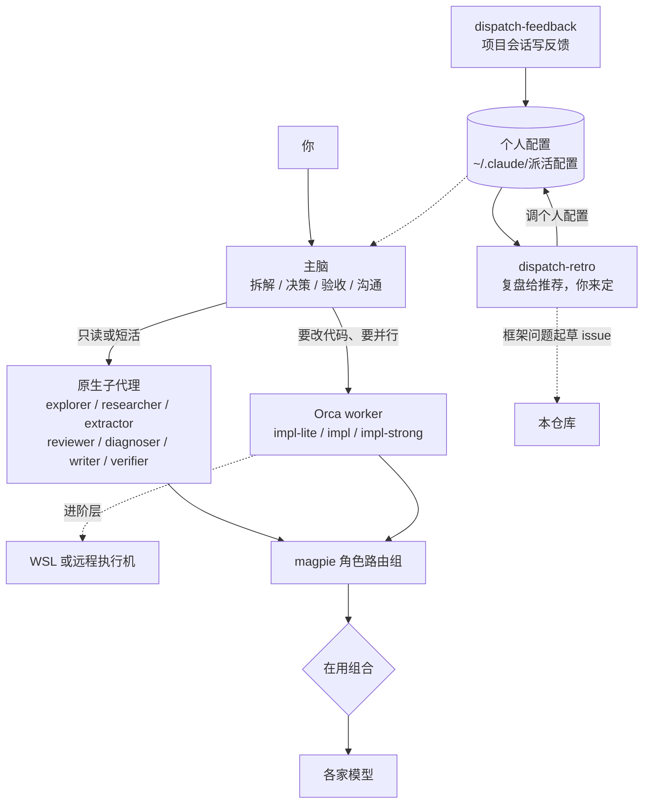

<div align="center">



# agent-dispatch

给 AI 编程 agent 的多模型派活框架：贵模型只做判断，便宜模型去干活；个人配置跟着你的用法复盘迭代。

[](https://github.com/lordfine/agent-dispatch/releases)
[](LICENSE)


[快速开始](#快速开始) · [使用指南](docs/使用指南.md) · [安装与自定义](docs/安装与自定义.md) · [设计决策](docs/设计决策.md) · [实测记录](docs/实测记录.md) · [更新记录](CHANGELOG.md)

</div>

## 它解决什么

Claude Code 默认把所有活都交给主会话那个模型。主会话是 Opus 这类强模型时，读十几个文件、搜一圈网页、写一份文档，全都按强模型的价格和速度走，长上下文还会让每次调用越来越贵。

这套框架把分工拆开：主会话只做拆解、决策、验收和跟你沟通，摸底、调研、审查、诊断、抽取、写文档、实现都派给更合适的模型。派给谁、规格怎么写、怎么验收、报错怎么改派，写成一个派活技能，主会话照着走。

每个人手里的资源不一样：有人机器好、额度足、有 WSL，有人只有一台笔记本和按量计费的模型。所以 GitHub 上的是框架，你自己的并发、额度、模型组合放在个人配置里；装好后有一轮初始化引导帮你生成，之后每做完一批活写一份反馈，隔段时间复盘一次，个人配置跟着你的用法调整。

它不是一个程序，是一组技能、agent 定义和几个小脚本，跑起来不额外花 token。

## 三层，有哪层用哪层

| 层 | 需要 | 能做什么 |
|---|---|---|
| 基础层 | Claude Code 或 Codex | 主会话按手册把活派给 7 个具名子代理，按风险定流程轻重 |
| 底座层 | 加 [Orca](https://github.com/stablyai/orca)、[magpie](https://github.com/yetone/magpie) | Orca 并行起 worker 跑实现；magpie 把角色组路由到不同供应商的模型，一键换整套组合 |
| 进阶层 | 加 WSL 或远程 Linux 执行机、多模型组合 | 测试、构建、Docker 放到执行机上跑，全量测试排队不打架 |

初始化引导会探测你现在在哪一层，缺的那层装了能多什么，装不装由你定。

## 架构



所有模型名都写成 magpie 路由组，比如 `group/explore`，不直接写供应商型号。组名不带版本号，换供应商或模型升级时只改组合文件里的成员，agent 文件和命令都不用动。

## 三个技能

- `dispatch`：日常派活。按 Agent Skills 的渐进加载写：入口只放决策规则（派给谁、定风险档和推理档、规格要点、验收要点），Orca、远程执行机、验收与测试、组合与路由、配合其他技能各一篇参考，用到才读。
- `dispatch-retro`：初始化引导和复盘。第一次探测机器和工具、问偏好、生成个人配置；之后读反馈、magpie 用量和 Orca 派活历史，给出带证据的推荐，你点头才改；框架本身的问题起草成 issue。
- `dispatch-feedback`：项目会话做完一个批次时，按问题、代价、证据、建议、归属五栏写一份反馈，放进个人配置的收件箱。

Claude Code 和 Codex 读的是同一种 `SKILL.md` 格式，安装时加 `--codex` 就能两边共用。

## 角色分工

| agent | 干什么 | 路由组 |
|---|---|---|
| explorer 探索员 | 摸代码、找定义和调用链、恢复"项目做到哪了" | `group/explore` |
| researcher 尽调员 | 上网调研、选型对比、核实说法和版本号 | `group/research` |
| extractor 转录抽取员 | 对已有材料逐字转录、抽字段、统计 | `group/extract` |
| reviewer 审查员 | 审查改动或方案，安全、正确性两轴分开派 | `group/review` |
| diagnoser 诊断员 | 排障只取证，给假设、验证命令、回滚方案 | `group/diagnose` |
| writer 文档员 | 把定好的结论写成文档初稿 | `group/write` |
| verifier 复核员 | 关键决策复核、上线前验收、结论冲突裁决，少用 | `group/verify` |

要改代码的活交给 Orca worker：清单式的确定性活用 `group/impl-lite`，常规实现用 `group/impl`，复杂跨模块的用 `group/impl-strong`；推理档位由主脑每次按难度在 medium、high、xhigh 里选。三个实现组只是分组定义，组里放什么模型按你的额度在组合里定。

仓库带两份示例组合：`国产.txt`（GLM / MiniMax / DeepSeek）和 `Codex.txt`（Codex 的 Terra / Sol / Astra），都只是参考搭配。

## 快速开始

```text
git clone https://github.com/lordfine/agent-dispatch.git
cd agent-dispatch
python 安装.py --演练     # 先看要做什么
python 安装.py            # Linux / macOS / WSL 用 python3；要给 Codex 也装，加 --codex
```

安装脚本只动 `~/.claude/skills/` 下的三个技能目录和 `~/.claude/agents/` 下的 7 个 agent，替换前先备份；你改过的 agent 默认保留；个人配置和 `~/.claude/CLAUDE.md` 不碰。

装完新开一个 Claude Code 会话，说：

> 初始化派活

引导会做这几件事：说清框架怎么分工；探测你的机器、工具和模型来源；把探测不出来的事一次问完（每个问题给推荐）；生成个人配置 `~/.claude/派活配置/`；问你要不要把 [CLAUDE.md片段.md](CLAUDE.md片段.md) 加进全局规则；应用组合（改 magpie 前先征得同意）；最后派一个小活核对模型落点。

之后日常就是说人话："这个项目两周没碰了，看看做到哪了"、"这两张票互不依赖，开两个 worker 并行做"。做完一批说"写反馈"，隔段时间说"复盘"。

升级：`git pull` 后重跑 `python 安装.py`，个人配置原样保留。从 v2 升级看 [安装与自定义](docs/安装与自定义.md#从-v2-升级)。

## 几个例子

**两周没碰的项目，想知道现状。** 你说"这个项目我两周没碰了，看看做到哪了"。主脑派 explorer 去读，回来是一份带路径和行号的结论清单，主脑只负责判断哪些是重点。

**从想法做到合并。** `/grill-with-docs` 把需求拷问清楚，`/to-spec` 出规格，`/to-tickets` 拆票。主脑给每张票定风险档和推理档，照规格模板写说明，派 Orca worker 并行做；worker 交付带改动统计和测试证据，停在"改完未提交"。大档票交付前排队跑一次全量，集成前再跑一次；合并和 push 前先问你。

**复盘一次。** 一批活做完，项目会话说"写反馈"，记下返工了几轮、哪条规则不好用、哪个模型落点不对。过几天你说"复盘"，`dispatch-retro` 读这些反馈和 magpie 用量，告诉你比如"探索组九成落到了兜底模型，原因是每分钟名额满了，建议把前台并行的子代理从 3 个降到 2 个"，你点头才改。

## 目录结构

```text
agent-dispatch/
├── 安装.py                  安装或升级（只动框架文件，先备份）
├── CLAUDE.md片段.md         贴进全局 CLAUDE.md 的规则片段
├── agents/                  7 个具名子代理
├── skills/
│   ├── dispatch/            日常派活
│   │   ├── SKILL.md         入口：决策规则
│   │   ├── 参考/            Orca、远程执行机、验收与测试、组合与路由、配合其他技能
│   │   ├── 模板/            规格、交付、WSL 审查、浏览器、预热、派活记录
│   │   ├── 组合/            两份示例组合和切换脚本
│   │   ├── 脚本/            体检、落点检查、WSL 衔接、全量排队（跑起来不花 token）
│   │   └── WSL/             把 Windows 配置同步到 WSL
│   ├── dispatch-retro/      初始化引导和复盘
│   └── dispatch-feedback/   写反馈
├── magpie/                  路由组和档位的建法、改法
└── docs/                    使用指南、安装与自定义、设计决策、实测记录
```

个人配置不在仓库里，装好后在 `~/.claude/派活配置/`（环境变量 `DISPATCH_CONFIG_DIR` 可改）。

## 文档

- [使用指南](docs/使用指南.md)：装完是什么样、什么话会派给谁、实现类任务怎么派、组合怎么切、WSL 两种用法、反馈和复盘。
- [安装与自定义](docs/安装与自定义.md)：安装脚本、初始化引导、个人配置里有什么、换模型、改角色和权限、从 v2 升级。
- [设计决策](docs/设计决策.md)：为什么这么分工、为什么拆成三个技能、为什么框架和个人配置分开、踩过哪些坑。
- [实测记录](docs/实测记录.md)：模型落点、主动派用、档位、WSL，以及一个实战项目三个批次的数据。

## 参与

用的过程中发现框架的问题（规则缺失或过时、脚本出错、模板不好用），欢迎提 [issue](https://github.com/lordfine/agent-dispatch/issues/new/choose)。复盘技能会帮你按模板起草，提交前记得去掉密钥、账号、内网地址和个人路径。

## 相关项目

- [mattpocock/skills](https://github.com/mattpocock/skills)：流程技能（拷问、出规格、拆票、实现、审查），手册里写了怎么配合。
- [magpie](https://github.com/yetone/magpie)：本地模型网关，负责路由组和档位。官网 https://usemagpie.ai 。
- [Orca](https://github.com/stablyai/orca)：并行起 worker 会话、管理工作区和远程执行机。官网 https://onOrca.dev 。
- [Agent Skills](https://agentskills.io)：Claude Code 和 Codex 共用的技能格式标准，渐进加载的思路来自这里。
- [lordfine/codex-claude-bridge](https://github.com/lordfine/codex-claude-bridge)：把 Codex 接进来用的另一套思路，主控写死在 Codex 上，和本项目的取舍不同。

## 许可

MIT。
