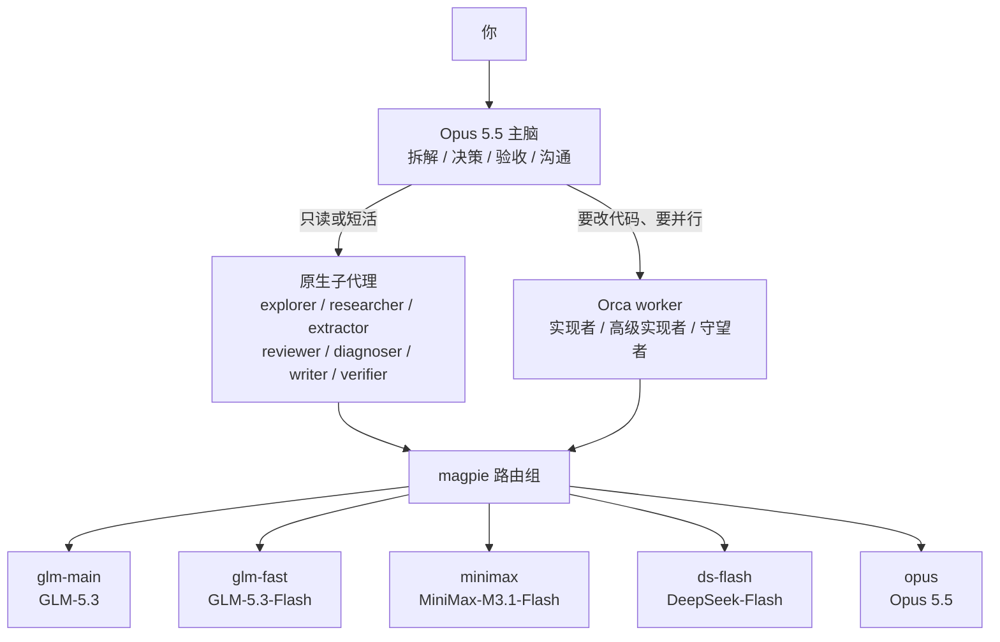

<div align="center">

# agent-dispatch

给 AI 编程 agent 的多模型派活配置：贵模型只做判断，便宜模型去干活。

当前实现是 Claude Code，配置在 `claude-code/` 目录。Codex 版在规划中，`codex/` 目录尚未提供。

[](LICENSE)


[使用指南](docs/使用指南.md) · [安装与自定义](docs/安装与自定义.md) · [设计决策](docs/设计决策.md) · [实测记录](docs/实测记录.md)


</div>

## 它解决什么

Claude Code 默认把所有活都交给主会话那个模型。主会话是 Opus 5.5 时，读十几个文件、搜一圈网页、写一份文档，全都按 Opus 的价格和速度走，长上下文还会让每次调用越来越贵。

这套配置把分工拆开：Opus 5.5 只做拆解、决策、验收和跟你沟通这四件事，摸底、调研、审查、诊断、抽取、写文档、实现全部派给便宜的国产模型（GLM-5.3、GLM-5.3-Flash、MiniMax-M3.1-Flash、DeepSeek-Flash）。派给谁、怎么派、怎么验收，写成一个派活手册 skill，配一段全局 CLAUDE.md 规则，主会话就照这个走。

它不是一个程序，没有代码要装，就是一组配置文件：7 个子代理定义、1 个 skill、1 段 CLAUDE.md 片段、1 份 magpie 路由组配置说明。

## 架构



所有模型名都写成 magpie 路由组，比如 `group/glm-fast`，不直接写供应商型号。换供应商或模型升级时只改组成员，agent 文件和命令都不用动。

图上画的是 Claude Code 版的流程。Codex 版还在规划中，目录和文档都还没提供，接法会另算。

## 角色分工

| agent | 干什么 | 模型 |
|---|---|---|
| explorer 探索员 | 摸代码、找定义和调用链、恢复"项目做到哪了" | MiniMax · medium |
| researcher 尽调员 | 上网调研、选型对比、核实说法和版本号 | glm-5.3-flash |
| extractor 转录抽取员 | 对已有材料逐字转录、抽字段、统计 | MiniMax · medium |
| reviewer 审查员 | 审查改动或方案，按安全、正确性两轴分开派 | glm-5.3-flash |
| diagnoser 诊断员 | 排障只取证，给假设、验证命令、回滚方案 | glm-5.3-flash |
| writer 文档员 | 把定好的结论写成文档初稿 | deepseek-flash |
| verifier 复核员 | 关键决策复核、上线前验收、结论冲突裁决，少用 | Opus 5.5 |

要改代码的活不走子代理，交给 Orca worker：常规实现用 `group/glm-fast`，复杂跨模块的用 `group/glm-main`，盯外部会话的守望者用 `group/minimax`。Sonnet 5.5 只在你点名时用。

## 快速开始

仓库在 https://github.com/lordfine/agent-dispatch ，按下面的步骤在自己的机器上装。

依赖三样：Claude Code；magpie（本机运行的模型网关，负责把模型名路由到不同供应商）；Orca 和 mattpocock/skills 可选。

1. 备份 `~/.claude/agents` 目录和 `~/.claude/CLAUDE.md`，出问题能退回去。
2. 把 `claude-code/agents/` 下 7 个文件拷到 `~/.claude/agents/`。
3. 把 `claude-code/skills/dispatch/` 整个目录拷到 `~/.claude/skills/`。
4. 把 [claude-code/CLAUDE.md片段.md](claude-code/CLAUDE.md片段.md) 里的代码块贴进 `~/.claude/CLAUDE.md`。
5. 按 [magpie/路由组与档位.md](magpie/路由组与档位.md) 建五个路由组、把 Claude Code 的各档位指向组。然后新开一个会话——CLAUDE.md 不会在当前会话里热加载。

装完在主会话里说一句"派 explorer 看看这个项目做到哪了"，如果回复里带文件路径和行号，说明生效了。

想换成自己的模型和供应商，看 [安装与自定义](docs/安装与自定义.md)。

## 三个例子

**两周没碰的项目，想知道现状。** 你说"这个项目我两周没碰了，看看做到哪了"。Opus 派 explorer 去读，回来是一份带路径和行号的结论清单，Opus 只负责判断哪些是重点。

**要核实一个版本号。** 你说"让 researcher 查一下这个库最新版有没有支持某个特性，只要官方来源"。researcher 会走官方接口而不是网页缓存，每条事实标已核实或未核实并附来源。你说"查一下"，Opus 自己也会派，但点名能保证这一次一定给它。

**从想法做到合并。** 先用 `/grill-with-docs` 把需求拷问清楚，`/to-spec` 出规格，`/to-tickets` 拆票。然后离开 Opus 会话，用 `claude --model group/glm-main` 开一个实现会话，每张票 `/implement`，票与票之间 `/clear`。回到 Opus 会话跑 `/code-review`，它会并行派两个 reviewer 分别查编码规范和需求符合度。合并和 push 前会先问你。

## 目录结构

```text
agent-dispatch/
├── claude-code/            当前实现，Claude Code 用
│   ├── agents/             7 个具名子代理，frontmatter 里写死模型
│   ├── skills/dispatch/    派活手册：派给谁、怎么写任务说明、怎么验收、报错怎么改派
│   └── CLAUDE.md片段.md    贴进全局 CLAUDE.md 的规则片段
├── magpie/                 路由组与档位的建法和改法
└── docs/                   使用指南、安装与自定义、设计决策、实测记录
```

## 文档

- [使用指南](docs/使用指南.md)：从安装到日常使用，新项目、老项目、各种说法对应什么行为。
- [安装与自定义](docs/安装与自定义.md)：第一次装好后，把它改成你自己的模型、供应商、角色和权限。
- [设计决策](docs/设计决策.md)：为什么这么分工，为什么用具名 agent 和路由组，踩过哪些坑，哪些方案被放弃了。
- [实测记录](docs/实测记录.md)：2026-11-04 实测的模型落点、主动派用效果和发现的问题。

## 相关项目

- [mattpocock/skills](https://github.com/mattpocock/skills)：流程技能（拷问、出规格、拆票、实现、审查），这套配置里的分工和它配套。
- [magpie](https://github.com/yetone/magpie)：本地模型网关，负责路由组和档位。官网是 https://usemagpie.ai 。
- [Orca](https://github.com/stablyai/orca)：并行起 worker 会话的工具，用来跑实现类任务。官网是 https://onOrca.dev 。
- [lordfine/codex-claude-bridge](https://github.com/lordfine/codex-claude-bridge)：把 Codex 接进来用的另一套思路，主控写死在 Codex 上，和本项目的取舍不同，供参考。

## 许可

MIT。
