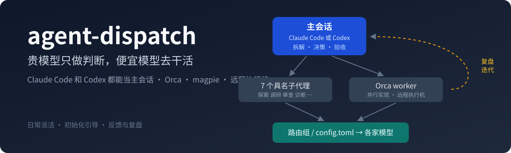
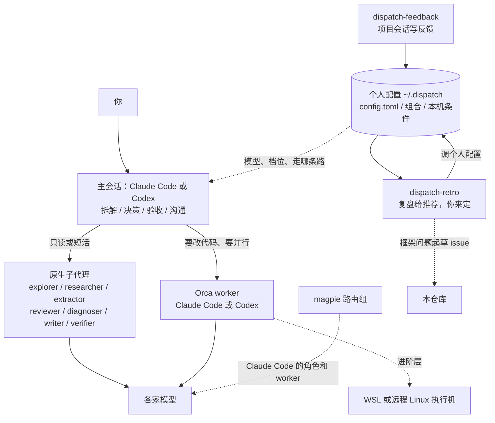

<div align="center">



# agent-dispatch

给 AI 编程 agent 的多模型派活框架：贵模型只做判断，便宜模型去干活。Claude Code 和 Codex 都能当主会话，个人配置跟着你的用法复盘迭代。

[](https://github.com/lordfine/agent-dispatch/releases)
[](LICENSE)


[快速开始](#快速开始) · [使用指南](docs/使用指南.md) · [安装与自定义](docs/安装与自定义.md) · [设计决策](docs/设计决策.md) · [实测记录](docs/实测记录.md) · [更新记录](CHANGELOG.md)

</div>

## 它解决什么

AI 编程 agent 默认把所有活都交给主会话那个模型。主会话是 Opus、Codex 强模型这一档时，读十几个文件、搜一圈网页、写一份文档，全都按强模型的价格和速度走，长上下文还会让每次调用越来越贵。

这套框架把分工拆开：主会话只做拆解、决策、验收和跟你沟通，摸底、调研、审查、诊断、抽取、写文档、实现都派给更合适的模型。派给谁、规格怎么写、怎么验收、报错怎么改派，写成一个派活技能，主会话照着走。

每个人手里的资源不一样：有人两种 CLI 都有、额度足、有 WSL 或远程开发机，有人只有一个 Codex 账号和一台笔记本。所以 GitHub 上的是框架，你自己的并发、额度、模型组合放在个人配置里；装好后有一轮初始化引导帮你生成，之后每做完一批活写一份反馈，隔段时间复盘一次，个人配置跟着你的用法调整。

它不是一个程序，是一组技能、角色定义和几个小脚本，跑起来不额外花 token。

## 两种主会话

同一份手册、同一套角色正文，两边都能用：

- **Claude Code 当主会话**：7 个角色是 `~/.claude/agents/` 下的 agent 文件，模型写成 magpie 路由组（比如 `group/explore`），换一套模型只改组合文件。只读角色有工具层面的隔离。
- **Codex 当主会话**：7 个角色是 `~/.codex/agents/` 下的 toml，只写名字和角色说明；派子代理时主会话按个人配置 `~/.dispatch/config.toml` 传模型和档位。只有 Codex、没装 magpie 也能用，安装器会写一份默认配置。

实现类的活两边都交给 [Orca](https://github.com/stablyai/orca) worker，worker 用 Claude Code 还是 Codex 由配置决定，跟主会话是谁无关。两边的具体差别（装在哪、模型怎么传、只读怎么核对、怎么查实际模型）写在手册的 `参考/宿主差异.md`。

## 三层，有哪层用哪层

| 层 | 需要 | 能做什么 |
|---|---|---|
| 基础层 | Claude Code 或 Codex | 主会话按手册把活派给 7 个具名子代理，按风险定流程轻重 |
| 底座层 | 加 Orca、[magpie](https://github.com/yetone/magpie) | Orca 并行起 worker 跑实现；magpie 把角色组路由到不同供应商的模型，一键换整套组合 |
| 进阶层 | 加 WSL 或远程 Linux 执行机 | 测试、构建、Docker 放到执行机上跑；一条命令把规则、角色、技能和配置同步过去 |

初始化引导会探测你现在在哪一层，缺的那层装了能多什么，装不装由你定。

## 架构



模型名不写死在角色里。Claude Code 下写 magpie 路由组，组名不带版本号，换供应商或模型升级只改组合文件；Codex 下写在 `config.toml`，项目根的 `.dispatch.toml` 可以覆盖个人配置。`脚本/生效配置.py` 列出两份合并后每个角色实际用什么、来自哪一份。

## 三个技能

- `dispatch`：日常派活。按 Agent Skills 的渐进加载写：入口只放决策规则（派给谁、定风险档和推理档、规格要点、验收要点），宿主差异、Orca、远程执行机、验收与测试、组合与路由、配合其他技能各一篇参考，用到才读。
- `dispatch-retro`：初始化引导和复盘，只能手动运行（Claude Code 里 `/dispatch-retro`，Codex 里 `$dispatch-retro`）。第一次探测机器和工具、问偏好、生成个人配置；之后读反馈、用量和 Orca 派活历史，给出带证据的推荐，你点头才改；框架本身的问题起草成 issue。
- `dispatch-feedback`：项目会话做完一个批次时，按问题、代价、证据、建议、归属五栏写一份反馈，放进个人配置的收件箱。

## 角色分工

| 角色 | 干什么 | Claude Code 示例落点 | Codex 默认配置 |
|---|---|---|---|
| explorer 探索员 | 摸代码、找定义和调用链、恢复"项目做到哪了" | `group/explore` | Terra · medium |
| researcher 尽调员 | 上网调研、选型对比、核实说法和版本号 | `group/research` | Sol · high |
| extractor 转录抽取员 | 对已有材料逐字转录、抽字段、统计 | `group/extract` | Terra · medium |
| reviewer 审查员 | 审查改动或方案，安全、正确性两轴分开派 | `group/review` | Sol · xhigh |
| diagnoser 诊断员 | 排障只取证，给假设、验证命令、回滚方案 | `group/diagnose` | Sol · high |
| writer 文档员 | 把定好的结论写成文档初稿 | `group/write` | Terra · high |
| verifier 复核员 | 关键决策复核、上线前验收、结论冲突裁决，少用 | `group/verify` | Sol · xhigh |

要改代码的活交给 Orca worker。Claude Code 下按难度分三个组：清单式的确定性活用 `group/impl-lite`，常规实现用 `group/impl`，复杂跨模块的用 `group/impl-strong`；Codex 默认配置里实现者是 Codex worker、Sol、high。推理档位由主会话每次按难度在 medium、high、xhigh 里选。表里的模型都只是示例，按你的额度改。

仓库带两份 magpie 示例组合：`国产.txt`（GLM / MiniMax / DeepSeek）和 `Codex.txt`（Codex 的 Terra / Sol / Astra）。

## 快速开始

```text
git clone https://github.com/lordfine/agent-dispatch.git
cd agent-dispatch
python 安装.py --演练     # 先看要做什么
python 安装.py            # Linux / macOS / WSL 用 python3
```

安装器按本机装了什么自动选宿主，两种都装了的默认装 Claude Code 并提示你，要两边都装就加 `--宿主 both`。它只动框架文件：Claude Code 是 `~/.claude/skills/` 下的三个技能和 `~/.claude/agents/` 下的 7 个 agent；Codex 是 `~/.agents/skills/` 下的三个技能和 `~/.codex/agents/` 下的 7 个角色，还没有个人配置时另写一份默认的 `~/.dispatch/config.toml`。替换前先备份到 `~/.dispatch/备份/`；你改过的 agent 默认保留；已有的个人配置、全局规则和宿主自己的配置不碰。

装完新开一个会话，Claude Code 里输入 `/dispatch-retro`，Codex 里输入 `$dispatch-retro`。引导会说清框架怎么分工；探测你的机器、工具和模型来源；把探测不出来的事一次问完（每个问题给推荐）；生成或补全个人配置；问你要不要把规则片段（Claude Code 用 [CLAUDE.md片段.md](CLAUDE.md片段.md)，Codex 用 [AGENTS.md片段.md](AGENTS.md片段.md)）加进全局规则；用 magpie 的应用组合（改 magpie 前先征得同意）；最后派一个小活核对模型落点。

之后日常就是说人话："这个项目两周没碰了，看看做到哪了"、"这两张票互不依赖，开两个 worker 并行做"。做完一批说"写反馈"，隔段时间运行一次 `dispatch-retro` 复盘。

有 WSL 或远程 Linux 开发机的，登记进个人配置的 `执行机.toml`，然后在主机上：

```text
python <本技能目录>/脚本/同步执行机.py <执行机名>           # 先预览要改什么
python <本技能目录>/脚本/同步执行机.py <执行机名> --执行     # 备份后写入，写完调一次模型验证
python <本技能目录>/脚本/同步执行机.py <执行机名> --装CLI    # 预览在执行机上装和主机同版本的 Claude Code、Codex
```

升级：`git pull` 后重跑 `python 安装.py`，个人配置原样保留。从 v3.1 及以前升级、从 v2 升级，看 [安装与自定义](docs/安装与自定义.md)。

## 几个例子

**两周没碰的项目，想知道现状。** 你说"这个项目我两周没碰了，看看做到哪了"。主会话派 explorer 去读，回来是一份带路径和行号的结论清单，主会话只负责判断哪些是重点。

**从想法做到合并。** `/grill-with-docs` 把需求拷问清楚，`/to-spec` 出规格，`/to-tickets` 拆票。主会话给每张票定风险档和推理档，照规格模板写说明，派 Orca worker 并行做；worker 交付带改动统计和测试证据，停在"改完未提交"。大档票交付前排队跑一次全量，集成前再跑一次；合并和 push 前先问你。

**只有 Codex 的同事。** 装好后在 Codex 里说"派 reviewer 审一下这次改动"。主会话先跑 `生效配置.py` 看 reviewer 该用什么模型和档位，按配置派子代理；因为 Codex 没法从工具上限制只读，派之前和交回之后各看一次 `git status --short`，多出改动就停下告诉你。

**复盘一次。** 一批活做完，项目会话说"写反馈"，记下返工了几轮、哪条规则不好用、哪个模型落点不对。过几天你运行 `dispatch-retro`，它读这些反馈和用量，告诉你比如"探索组九成落到了兜底模型，原因是每分钟名额满了，建议把前台并行的子代理从 3 个降到 2 个"，你点头才改。

## 目录结构

```text
agent-dispatch/
├── 安装.py                  安装或升级（按宿主装，只动框架文件，先备份）
├── CLAUDE.md片段.md         贴进 Claude Code 全局 CLAUDE.md 的规则片段
├── AGENTS.md片段.md         贴进 Codex 全局 AGENTS.md 的规则片段
├── agents/                  7 个角色的正文（Claude Code 直接用，Codex 由安装器生成 toml）
├── skills/
│   ├── dispatch/            日常派活
│   │   ├── SKILL.md         入口：决策规则
│   │   ├── 参考/            宿主差异、Orca、远程执行机、验收与测试、组合与路由、配合其他技能
│   │   ├── 模板/            规格、交付、WSL 审查、浏览器、预热、派活记录、Codex 默认个人配置、执行机示例
│   │   ├── 组合/            两份示例组合和切换脚本
│   │   ├── 脚本/            体检、生效配置、同步执行机、落点检查、规格路径检查、WSL 衔接、全量排队（跑起来不花 token）
│   │   └── WSL/             旧的 WSL 同步入口（内部改调同步执行机）
│   ├── dispatch-retro/      初始化引导和复盘
│   └── dispatch-feedback/   写反馈
├── magpie/                  路由组和档位的建法、改法
└── docs/                    使用指南、安装与自定义、设计决策、实测记录
```

个人配置不在仓库里，在 `~/.dispatch/`（环境变量 `DISPATCH_CONFIG_DIR` 可改；v3.1 及以前的旧位置 `~/.claude/派活配置/` 照样能用）。

## 文档

- [使用指南](docs/使用指南.md)：装完是什么样、什么话会派给谁、Codex 当主会话时有什么不同、实现类任务怎么派、组合怎么切、执行机怎么用、反馈和复盘。
- [安装与自定义](docs/安装与自定义.md)：安装脚本、初始化引导、个人配置和 `config.toml` 写法、换模型、改角色和权限、同步到执行机、从旧版本升级。
- [设计决策](docs/设计决策.md)：为什么这么分工、为什么两种主会话共用一套正文、为什么框架和个人配置分开、执行机同步为什么这么定、踩过哪些坑。
- [实测记录](docs/实测记录.md)：模型落点、主动派用、档位、WSL、Codex 主会话和执行机同步的实测，以及一个实战项目三个批次的数据。

## 参与

用的过程中发现框架的问题（规则缺失或过时、脚本出错、模板不好用），欢迎提 [issue](https://github.com/lordfine/agent-dispatch/issues/new/choose)。复盘技能会帮你按模板起草，提交前记得去掉密钥、账号、内网地址和个人路径。

## 相关项目

- [mattpocock/skills](https://github.com/mattpocock/skills)：流程技能（拷问、出规格、拆票、实现、审查），手册里写了怎么配合。
- [magpie](https://github.com/yetone/magpie)：本地模型网关，负责路由组和档位。官网 https://usemagpie.ai 。
- [Orca](https://github.com/stablyai/orca)：并行起 worker 会话、管理工作区和远程执行机。官网 https://onOrca.dev 。
- [Agent Skills](https://agentskills.io)：Claude Code 和 Codex 共用的技能格式标准，渐进加载的思路来自这里。
- [lordfine/codex-claude-bridge](https://github.com/lordfine/codex-claude-bridge)：把 Codex 和 Claude Code 接在一起的另一套思路，主控固定在 Codex 上；本项目让两边都能当主会话。

## 许可

MIT。
